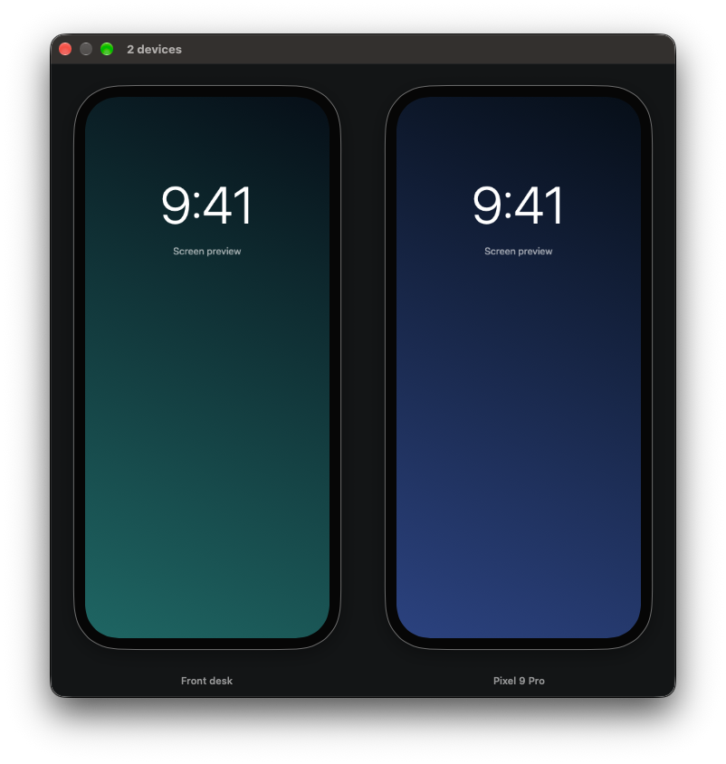
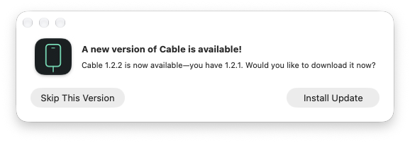

# Cable

Your phone. Right here.

A tiny native Mac app that shows USB-connected iPhones, iPads, and Android phones. Plug in and the screen appears. No account, recording, or phone app to install.



*App screenshot with example phone content.*

## Install

Requires **macOS 14 or later**, on Apple silicon or Intel.

Open `Cable.dmg` from [Releases](https://github.com/stephenson/Cable/releases), drag Cable to Applications, and open it.

*The first signed release is pending Apple signing setup. For now, build locally below.*

### iPhone & iPad

Allow Camera access when Cable asks, connect with a USB data cable, unlock, and tap **Trust**. macOS calls screen-capture access “Camera”; Cable does not record anything.

### Android

1. Settings → About phone → tap **Build number** seven times.
2. Developer options → enable **USB debugging**.
3. Connect, unlock, and accept **Allow USB debugging**.

Choose **Always allow from this computer** for automatic reconnection. Only authorize computers you trust. No macOS Camera permission or separate adb installation needed. These steps are also in **Cable → About Cable**.

## Make it yours

- Connect several phones—even a mix of iPhone and Android—to see them side by side.
- **Click a name** to rename it. Return saves; Escape cancels; clearing restores the original.
- **Drag a phone frame** onto another to reorder. Names and order are remembered on this Mac.
- Rotate a phone and the window adjusts. Unplug and reconnect whenever you like.

Viewing only: no remote control, audio playback, or recording. Protected video may be blank.

## Updates

Sparkle checks for updates with your permission and asks before installing. You can also choose **Cable → Check for Updates…**.



*Standard update dialog, captured using a local test feed.*

Version 1.2.1 needs one manual upgrade to gain the updater.

## Troubleshooting

Use a data-capable cable and keep the phone unlocked. On iPhone, accept **Trust** and check **System Settings → Privacy & Security → Camera**. On Android, accept the USB debugging prompt. More help is in Cable’s Help menu.

Local builds are not notarized. If macOS blocks a trusted build, use **System Settings → Privacy & Security → Open Anyway** after trying to open it.

## Build

Requires Xcode, Python 3.10+, and Internet access.

```bash
bash build.sh
```

Produces a universal app, DMG, and ZIP in `build/`. Set `PYTHON=/path/to/python3.12` if needed. Run `bash test.sh` to test an existing build.

Maintainers: see the [release guide](Release/README.md) for signing and GitHub publishing.
